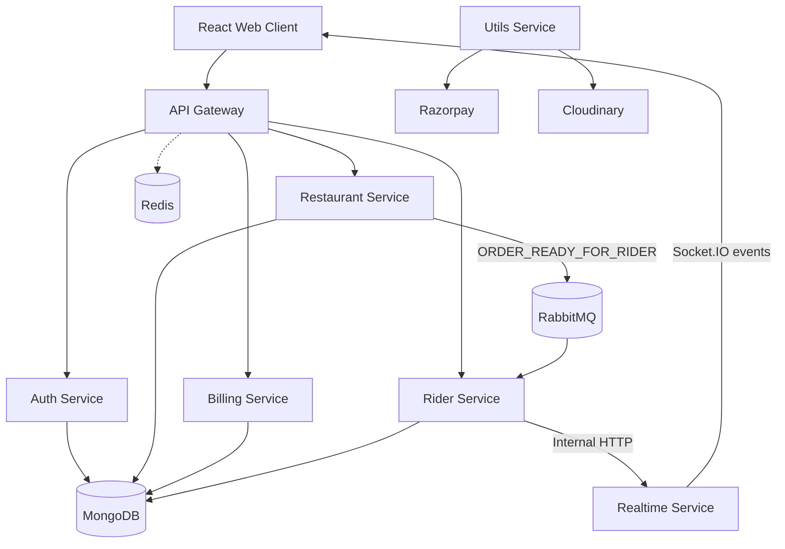

# CraveHub — Microservices-Based Food Ordering & Delivery Platform

CraveHub is a food ordering and delivery platform I built to practice real-world backend engineering: microservices, asynchronous messaging, real-time updates, geospatial rider matching, and role-based workflows. It serves four kinds of users in one application: customers, restaurant owners, delivery riders, and admins.

> **Project status:** The backend services are containerized with Docker and tested locally. A live AWS deployment is pending because of resource constraints, so the project is not publicly hosted yet.

## Table of Contents

- [Features](#features)
- [Architecture](#architecture)
- [Services](#services)
- [Technology Stack](#technology-stack)
- [Key Workflows](#key-workflows)
- [Getting Started](#getting-started)
- [Environment Configuration](#environment-configuration)
- [Future Improvements](#future-improvements)
- [Author](#author)

## Features

**Customer**

- Browse restaurants and place food orders.
- Pay online through Razorpay.
- Follow order status updates in real time.

**Restaurant**

- Manage menu items and open or close the restaurant.
- Manage incoming orders and move them through `accepted`, `preparing`, and `ready_for_rider`.
- Marking an order `ready_for_rider` starts the rider-discovery workflow.

**Delivery rider**

- Set availability and location.
- Receive real-time notifications for nearby delivery requests.
- Accept an order and update its pickup and delivery status.

**Admin**

- Review pending restaurant and rider registrations.
- Verify restaurants and riders before they can operate.

## Architecture

Requests enter through an API Gateway and are routed to separate backend services. Services talk over HTTP when they need an immediate response, and over RabbitMQ for asynchronous, event-driven work such as rider discovery.



Key design points:

- **API Gateway:** single entry point that routes client requests to the right service.
- **RabbitMQ:** carries the `ORDER_READY_FOR_RIDER` event so rider discovery runs asynchronously instead of blocking the restaurant's request.
- **Socket.IO:** pushes order and rider notifications to connected clients.
- **MongoDB:** persistent storage; the database is the source of truth for order state.
- **Redis:** used for backend performance and rate limiting.
- **Internal service authentication:** internal endpoints validate a shared service key.

## Services

| Service | Responsibility |
|---|---|
| Auth | Registration, login, and role-based access for customers, restaurants, riders, and admins |
| Restaurant | Restaurants, menus, and order status updates |
| Billing | Order billing and the payment-related workflow |
| Utils | Razorpay payment integration and Cloudinary image uploads |
| Rider | Rider availability, location, verification, and geospatial matching |
| Realtime | Socket.IO server that delivers real-time events to users, restaurants, and riders |

## Technology Stack

| Area | Technologies |
|---|---|
| Backend | Node.js, Express.js, TypeScript, JavaScript |
| Frontend | React, Tailwind CSS, Context API, Axios |
| Database | MongoDB |
| Cache and rate limiting | Redis |
| Messaging | RabbitMQ |
| Real-time | Socket.IO |
| Payments and media | Razorpay, Cloudinary |
| Containerization | Docker |
| Cloud | AWS (deployment pending) |

## Key Workflows

### 1. Order and rider assignment

1. A customer places an order and pays through Razorpay.
2. The restaurant accepts and prepares the order.
3. When the restaurant marks it `ready_for_rider`, the Restaurant service publishes an `ORDER_READY_FOR_RIDER` event to RabbitMQ.
4. The Rider service consumes the event and finds riders who are verified, available, and within the configured distance of the restaurant.
5. The Realtime service sends each eligible rider an `order:available` notification over Socket.IO.
6. A rider accepts the order. The backend first checks that the order is still unassigned, so two riders cannot claim the same order.
7. The order moves through pickup and delivery, and connected clients receive each status update.

### 2. Real-time order updates

After an order changes, the backend asks the Realtime service to emit an event to the right user or restaurant room. The database stays the source of truth; the real-time event only tells clients that something changed.

### 3. Admin verification

Admins review pending restaurant and rider registrations and approve them through protected endpoints.

## Getting Started

### Prerequisites

- Docker and Docker Compose (recommended), or Node.js plus local MongoDB, Redis, and RabbitMQ
- A Razorpay test account and a Cloudinary account for payments and image uploads

### 1. Clone the repository

```bash
git clone https://github.com/MohitCode17/cravehub-food-ordering-app.git
cd cravehub-food-ordering-app
```

### 2. Configure environment variables

Each service and the frontend read their own `.env` file. Copy the provided `.env.example` in each folder to `.env` and fill in your own values. See [Environment Configuration](#environment-configuration).
<!-- VERIFY: add a .env.example to every service folder and the frontend, then confirm the sentence above is true. -->

### 3. Run the backend with Docker

```bash
docker compose up --build
```

Run this from the folder that contains `docker-compose.yml`. To stop everything:

```bash
docker compose down
```
<!-- VERIFY: the repo root shows no docker-compose.yml. State its real location here (for example: cd services) or move it to the root. -->

### 4. Run the frontend

```bash
cd frontend
npm install
npm run dev
```
<!-- VERIFY: confirm the frontend start script name in frontend/package.json. -->

## Environment Configuration

Never commit real credentials. Variables are grouped below by purpose; each service uses only the ones it needs.

| Purpose | Variables |
|---|---|
| Runtime | `PORT`, `NODE_ENV` |
| Database | `MONGODB_URI` |
| Redis | `REDIS_URL` |
| RabbitMQ | `RABBITMQ_URL` |
| Service URLs | `AUTH_SERVICE`, `RESTAURANT_SERVICE`, `RIDER_SERVICE`, `REALTIME_SERVICE` |
| Internal service auth | `INTERNAL_SERVICE_KEY` |
| Frontend origin | `FRONTEND_URL` |
| Auth | JWT secret and related settings |
| Payments and media | Razorpay key id and secret, Cloudinary cloud name, API key and secret |
<!-- VERIFY: replace the generic Auth and Payments rows with the exact variable names from your code. -->

## Future Improvements

- Add automated unit, integration, and end-to-end tests.
- Make event processing idempotent and add retry and dead-letter handling for RabbitMQ.
- Improve payment reconciliation and order-state recovery.
- Add structured logging, metrics, health checks, and distributed tracing.
- Set up a CI/CD pipeline and deploy to AWS.
- Publish API documentation.

## Author

**Mohit Gupta** — [GitHub](https://github.com/MohitCode17) · [LinkedIn](https://www.linkedin.com/in/mohit-gupta-519755245)
