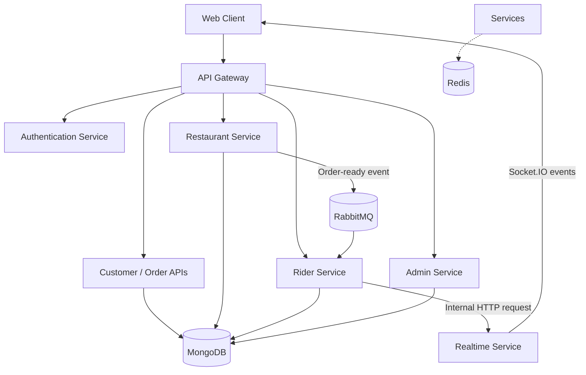

# CraveHub - Microservices Based Food Ordering & Delivery Platform

CraveHub is a food ordering and delivery platform built to explore
real-world backend engineering concepts, including **microservices,
asynchronous messaging, real-time updates, geospatial rider matching,
and role-based workflows**.

The platform brings together customers, restaurant owners, delivery
riders, and administrators in a single application.

> **Project status:** The backend microservices have been containerized using Docker and tested locally. Live deployment on AWS is currently pending due to resource constraints. The project is not yet publicly hosted.

## Table of Contents

-   [Features](#features)
-   [Architecture](#architecture)
-   [Technology Stack](#technology-stack)
-   [Key Workflows](#key-workflows)
-   [Getting Started](#getting-started)
-   [Environment Configuration](#environment-configuration)
-   [Running with Docker](#running-with-docker)
-   [Screenshots](#screenshots)
-   [Future Improvements](#future-improvements)

## Features

### Customer

-   Browse restaurants and place food orders.
-   Follow order status updates in real time.
-   Track delivery progress and rider location where enabled.
-   Use the application's supported authentication and payment flow.

### Restaurant

-   Manage menu items and open-close restaurant feature.
-   Manage incoming orders and update preparation status.
-   Move an order through supported states such as `accepted`,
    `preparing`, and `ready_for_rider`.
-   Trigger the rider-discovery workflow when an order is ready for
    pickup.

### Delivery Rider

-   Manage rider availability and location.
-   Receive real-time notifications for available delivery requests.
-   Accept an order and update its pickup and delivery status.

### Admin

-   Review pending restaurant and rider registrations.
-   Verify eligible restaurants and riders.

## Architecture

CraveHub is organized around separate backend services with an API entry
point and dedicated responsibilities. Services communicate using HTTP
for operations that require an immediate response and RabbitMQ for
asynchronous event-driven workflows.



*The diagram is a conceptual overview.*

### Architecture highlights

-   **API Gateway:** Provides a common entry point and routes client
    requests to backend services.
-   **Microservices:** Separates business responsibilities into
    independently organized services.
-   **RabbitMQ:** Carries asynchronous events, including the event that
    starts rider discovery after an order is ready.
-   **Socket.IO:** Delivers real-time order and rider notifications to
    connected clients.
-   **MongoDB:** Stores application data.
-   **Redis:** Supports fast-access backend functionality such as rate
    limiting, where configured.
-   **Internal service authentication:** Internal endpoints validate a
    shared service key where implemented.

## Technology Stack

| Area | Technologies |
|---|---|
| Backend | Node.js, Express.js, TypeScript, JavaScript |
| Database | MongoDB |
| Cache / Fast-Access Data | Redis |
| Messaging | RabbitMQ |
| Real-Time Communication | Socket.IO |
| Containerization | Docker |
| Cloud | AWS (live deployment pending) |

## Key Workflows

### 1. Order and rider assignment

1.  A customer places an order through the application.
2.  The backend processes the order and payment-related workflow.
3.  The restaurant accepts and prepares the order.
4.  When the restaurant marks the order `ready_for_rider`, it publishes
    an `ORDER_READY_FOR_RIDER` event to RabbitMQ.
5.  The rider service consumes the event and searches for riders who are
    verified, available, and within the configured distance of the
    restaurant.
6.  The real-time service sends eligible riders an `order:available`
    notification through Socket.IO.
7.  A rider attempts to accept the order. The backend checks whether the
    order is still unassigned before completing the assignment.
8.  The order proceeds through pickup and delivery, with relevant status
    updates sent to connected clients.

### 2. Real-time order updates

After relevant order changes, the backend asks the real-time service to
emit events to the appropriate user or restaurant room. The database
remains the persistent source of order state; real-time events notify
clients that a change has occurred.

### 3. Admin verification

Administrators can review pending restaurant and rider registrations and
update their verification status through protected endpoints.

## Getting Started

The exact startup commands and required environment variables depend on
the current repository structure. Use the steps below as a checklist and
replace placeholders with the values and scripts in your project.

### Prerequisites

-   Node.js version supported by the project
-   npm (or the package manager used by the repository)
-   MongoDB
-   Redis
-   RabbitMQ
-   Required third-party credentials for authentication, payments, maps,
    or other integrations enabled in your build
-   Docker and Docker Compose, if using the containerized setup

### Installation

1.  Clone the repository:

    ``` bash
    git clone git@github.com:MohitCode17/cravehub-food-ordering-app.git
    cd cravehub-food-ordering-app
    ```

2.  Install dependencies in the frontend and each backend service
    directory:

    ``` bash
    npm install
    ```

3.  Create the required environment files for the frontend and backend
    services. See [Environment
    Configuration](#environment-configuration).

4.  Start MongoDB, Redis, RabbitMQ, and any other required dependencies.

5.  Start the backend services using the scripts defined in each
    service's `package.json`.

6.  Start the frontend using the script defined in its `package.json`.

> There is no single universal `npm install` or start command for a
> multi-service repository unless a root workspace script has been
> configured. Check each service's `package.json` for the actual
> commands.

## Environment Configuration

Create local `.env` files based on the variables required by each
service. Variable names differ by service; consult its configuration
code and do not commit real credentials.

Common configuration categories may include:

  -----------------------------------------------------------------------
  Category                            Example variable names
  ----------------------------------- -----------------------------------
  Service runtime                     `PORT`, `NODE_ENV`

  Database                            `MONGODB_URI`

  Redis                               `REDIS_URL`

  RabbitMQ                            `RABBITMQ_URL`

  Service URLs                        `AUTH_SERVICE`,
                                      `RESTAURANT_SERVICE`,
                                      `RIDER_SERVICE`, `REALTIME_SERVICE`

  Internal service authentication     `INTERNAL_SERVICE_KEY`

  Frontend origin                     `FRONTEND_URL`

  Authentication provider             Provider-specific credentials

  Payments / maps                     Provider-specific API keys
  -----------------------------------------------------------------------

These are illustrative names, not a guarantee that every service uses
these exact variables. Verify the required variables from the code
before running the application.

## Running with Docker

If the repository includes Dockerfiles and a Docker Compose
configuration for the services, build and start the configured
containers from the directory containing the Compose file:

``` bash
docker compose up --build
```

To stop the containers:

``` bash
docker compose down
```

The commands above only work for services defined in the relevant
Compose file. Confirm which application services and dependencies are
actually containerized before using this as the complete startup
procedure.

## Screenshots

Add screenshots or a short demo GIF here to help reviewers understand
the user experience.

``` text
docs/
  screenshots/
    customer-home.png
    restaurant-dashboard.png
    rider-dashboard.png
    admin-dashboard.png
```

Replace these example filenames with screenshots that exist in your
repository. Avoid including personal information, access tokens, or real
customer data.

## Future Improvements

Potential next steps, depending on what is already implemented:

-   Add automated unit, integration, and end-to-end tests.
-   Add idempotent event processing and robust retry/dead-letter
    policies.
-   Improve payment reconciliation and order-state recovery.
-   Add structured logging, metrics, health checks, and distributed
    tracing.
-   Automate builds and deployments through a CI/CD pipeline.
-   Document API endpoints and provide sanitized example environment
    files.

## Author

**Mohit Gupta**

-   GitHub:
    [your-github-username](https://github.com/MohitCode17)
-   LinkedIn: [your-linkedin-profile](https://www.linkedin.com/in/mohit-gupta-519755245)
